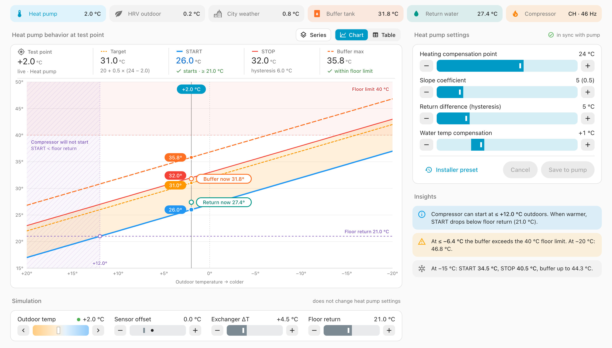
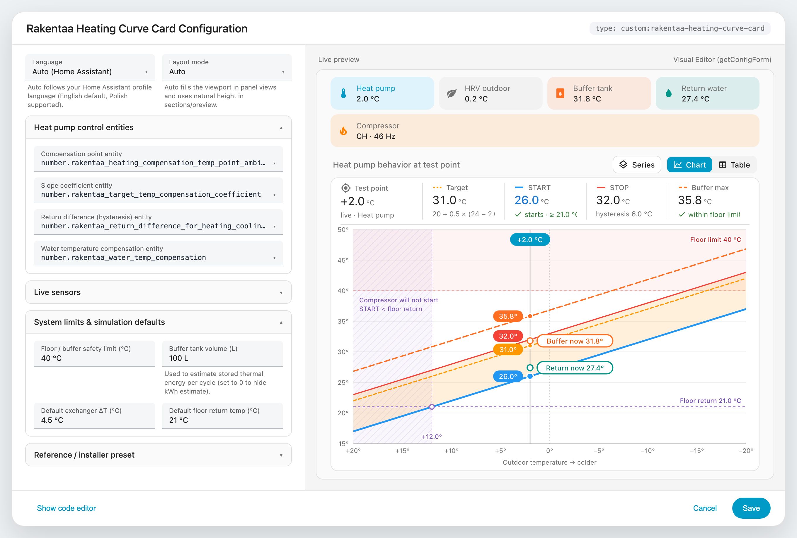

# Rakentaa Heating Curve Card

An interactive Home Assistant Lovelace custom card for monitoring, simulating, and tuning the weather-compensated heating curve of **Rakentaa** air-to-water heat pumps (Chico **CC1010B** controller, e.g. `RA040-PW13-A3`).



---

## Features

- **Live Telemetry Bar**: Displays real-time heat pump outdoor temperature, optional secondary/tertiary reference outdoor sensors, buffer tank temperature, heating return temperature, and compressor status (`CH` / `DHW` / `idle` + frequency in Hz). Click any outdoor sensor badge to track it as the live test point.
- **Interactive SVG Heating Curve & Table View**:
  - Plots **START**, **STOP**, **Target**, **Buffer max**, **Floor return threshold**, and optional **Installer reference preset** curves across `+20 °C` to `−20 °C`.
  - Click, drag, hover, or use keyboard arrows (`←` / `→`) on the chart to inspect any outdoor temperature.
  - Highlights the **no-start zone** (`START < floor return`) and **floor safety limit zone** (`Buffer max > panel_limit`).
  - Switch between **Chart** and **Table** views at any time.
- **What-If Simulation Sliders**: Experiment with outdoor temperature, pump sensor offset (`bias`), heat exchanger `ΔT`, and floor return temperature without modifying heat pump settings.
- **Safe Heat Pump Parameter Tuning**:
  - Adjust compensation point, slope coefficient, return difference (hysteresis), and water temperature compensation with instant visual feedback and reference dots showing current controller values.
  - Review an exact before/after diff and impact summary in a confirmation modal before writing changes via `hass.callService`.
  - Only modified parameters are sent to the controller.
- **Automated Insights**: Real-time diagnostics for unsaved changes, compressor cut-off outdoor temperature, buffer safety limit exceedance, and `−15 °C` design-point values.
- **Localization**: English (`en`), Polish (`pl`).

---

## Installation

### Option 1: HACS (Recommended)

1. Open **HACS** in Home Assistant.
2. Open the menu (`⋮`) → **Custom repositories**.
3. Add `https://github.com/cpiekacz/rakentaa-heating-curve-card` with category **Dashboard** (Plugin).
4. Click **Download**, then reload your browser (`Ctrl+Shift+R` / `Cmd+Shift+R`).

### Option 2: Manual Installation

1. Download [`rakentaa-heating-curve-card.js`](rakentaa-heating-curve-card.js) and copy it to `/config/www/rakentaa-heating-curve-card.js`.
2. In Home Assistant, go to **Settings → Dashboards → `⋮` → Resources → Add Resource**:
   - **URL**: `/local/rakentaa-heating-curve-card.js`
   - **Resource type**: `JavaScript module`
3. Reload your browser cache (`Ctrl+Shift+R` / `Cmd+Shift+R`).

### Optional: `tuya-local` Device Configuration for Rakentaa Heat Pump

If you integrate your Rakentaa heat pump (Chico CC1010B / `RA040-PW13-A3`) into Home Assistant using [`tuya-local`](https://github.com/make-all/tuya-local), this repository includes a ready-to-use device profile that exposes the heating curve parameters and live telemetry sensors:

1. Download [`tuya_local/devices/rakentaa_cc1010b_waterheater.yaml`](tuya_local/devices/rakentaa_cc1010b_waterheater.yaml).
2. Upload it to your Home Assistant `tuya_local` devices folder:
   ```text
   <config>/custom_components/tuya_local/devices/rakentaa_cc1010b_waterheater.yaml
   ```
3. Restart Home Assistant and add (or reload) the device in **Settings → Devices & Services → Tuya Local**.

---

## Usage

### Configuration

All entities, sensor labels, physical limits, and presets can be configured via the visual card editor or in YAML:



### Minimal Configuration (Full-Screen Panel View)

If your Home Assistant exposes standard Rakentaa entity IDs, no extra configuration is required:

```yaml
views:
  - title: Heating Curve
    path: simulator
    type: panel
    cards:
      - type: custom:rakentaa-heating-curve-card
```

### Full Configuration Example

```yaml
type: custom:rakentaa-heating-curve-card
language: auto # auto | en | pl
layout: auto   # auto | panel | card

# Heat pump control entities
comp_point_entity: number.rakentaa_heating_compensation_temp_point_ambient
coeff_entity: number.rakentaa_target_temp_compensation_coefficient
diff_entity: number.rakentaa_return_difference_for_heating_cooling_function
water_comp_entity: number.rakentaa_water_temp_compensation
auto_entity: select.rakentaa_heating_target_temp_automatic_adjustment
fixed_target_entity: number.rakentaa_heating_target_water_temp

# Live sensors
ambient_entity: sensor.rakentaa_ambient_temp
inlet_entity: sensor.rakentaa_water_inlet_temp
outlet_entity: sensor.rakentaa_water_outlet_temp
buffer_entity: sensor.heating_buffer_temperature
compressor_hz_entity: sensor.rakentaa_compressor_actual_frequency
heating_co_entity: binary_sensor.rakentaa_heating_co
heating_dhw_entity: binary_sensor.rakentaa_heating_cwu

# Optional reference outdoor sensors
outdoor_secondary_entity: sensor.hrv_outdoor_temperature
outdoor_secondary_name: HRV outdoor
outdoor_tertiary_entity: sensor.local_weather_temperature
outdoor_tertiary_name: City weather

# System limits & simulation defaults
panel_limit: 40
buffer_volume_l: 100
default_dt: 4.5
default_floor_return: 21
floor_note: "8 mm laminate + underlay (R = 0.064)"

# Reference / installer preset
installer_comp_point: 22
installer_coeff: 6
installer_diff: 8
installer_water_comp: 1
installer_dt: 6
```

### Configuration Options

| Option | Type | Default | Description |
| :--- | :--- | :--- | :--- |
| `language` | `string` | `auto` | UI language: `auto` (follows `hass.language`), `en`, or `pl`. |
| `layout` | `string` | `auto` | `auto` fills viewport in panel views and uses natural height in sections/preview; `panel` or `card` forces a layout mode. |
| `comp_point_entity` | `string` | `number.rakentaa_heating_compensation_temp_point_ambient` | Heating compensation outdoor reference point (`0–40 °C`). |
| `coeff_entity` | `string` | `number.rakentaa_target_temp_compensation_coefficient` | Curve slope coefficient (`1–30`, effective slope = value ÷ 10). |
| `diff_entity` | `string` | `number.rakentaa_return_difference_for_heating_cooling_function` | Return temperature hysteresis (`2–18 °C`). |
| `water_comp_entity` | `string` | `number.rakentaa_water_temp_compensation` | Target water temperature compensation (`-5..+15 °C`). |
| `auto_entity` | `string` | `select.rakentaa_heating_target_temp_automatic_adjustment` | Weather compensation enable/disable selector (English and Polish options detected automatically). |
| `fixed_target_entity` | `string` | `number.rakentaa_heating_target_water_temp` | Fixed target water temperature used when weather compensation is disabled (`15–55 °C`). |
| `ambient_entity` | `string` | `sensor.rakentaa_ambient_temp` | Heat pump built-in outdoor temperature sensor. |
| `inlet_entity` | `string` | `sensor.rakentaa_water_inlet_temp` | Heating return (inlet) water temperature sensor. |
| `outlet_entity` | `string` | `sensor.rakentaa_water_outlet_temp` | Heating supply (outlet) water temperature sensor. |
| `buffer_entity` | `string \| null` | `null` | Optional buffer tank temperature sensor. Badge and live marker appear when configured. |
| `compressor_hz_entity` | `string` | `sensor.rakentaa_compressor_actual_frequency` | Compressor frequency sensor (Hz). |
| `heating_co_entity` | `string` | `binary_sensor.rakentaa_heating_co` | Space heating active binary sensor. |
| `heating_dhw_entity` | `string` | `binary_sensor.rakentaa_heating_cwu` | Domestic hot water active binary sensor. |
| `outdoor_secondary_entity` | `string \| null` | `null` | Optional second outdoor temperature sensor (also used to compute live sensor offset against the pump sensor). |
| `outdoor_secondary_name` | `string` | Localized default | Custom display label for the secondary outdoor sensor badge. |
| `outdoor_tertiary_entity` | `string \| null` | `null` | Optional third outdoor temperature sensor (e.g. local weather station). |
| `outdoor_tertiary_name` | `string` | Localized default | Custom display label for the tertiary outdoor sensor badge. |
| `panel_limit` | `number` | `40` | Maximum safe buffer/water temperature (`25–65 °C`) for floor protection alerts. |
| `buffer_volume_l` | `number` | `100` | Buffer tank volume in liters (`0–2000`) for cycle energy estimate (`0` hides kWh estimate). |
| `default_dt` | `number` | `4.5` | Initial heat exchanger `ΔT` (`3–9 °C`). |
| `default_floor_return` | `number` | `21` | Initial underfloor loop return temperature (`18–25 °C`). |
| `floor_note` | `string` | `""` | Optional flooring specification note displayed in the buffer KPI tooltip. |
| `installer_comp_point` | `number` | `22` | Reference preset compensation point (`0–40 °C`). |
| `installer_coeff` | `number` | `6` | Reference preset slope coefficient (`1–30`). |
| `installer_diff` | `number` | `8` | Reference preset return difference (`2–18 °C`). |
| `installer_water_comp` | `number` | `1` | Reference preset water compensation (`-5..+15 °C`). |
| `installer_dt` | `number` | `6` | Reference preset exchanger `ΔT` (`3–9 °C`). |

---

## Heating Curve Model

The card implements the empirically verified Rakentaa / Chico CC1010B weather-compensation equations:

```text
T_sensor     = T_outdoor + bias
T_target     = clamp(20 + (coeff / 10) * (compPoint - T_sensor), 15, 55)
T_START      = T_target - diff
T_STOP       = T_target + waterComp
T_buffer_max = T_STOP + 0.85 * ΔT
T_outlet     = T_STOP + ΔT
T_cutoff     = compPoint - (T_floor_return + diff - 20) / (coeff / 10) - bias
```

When `T_START < T_floor_return`, return water from the underfloor heating loop will not cool down enough to trigger compressor startup. When `T_buffer_max > panel_limit`, peak buffer temperature exceeds the configured flooring safety threshold.

---

## Localization

- English (`en`)
- Polish (`pl`)

---

## License

This project is licensed under the [MIT License](LICENSE).
